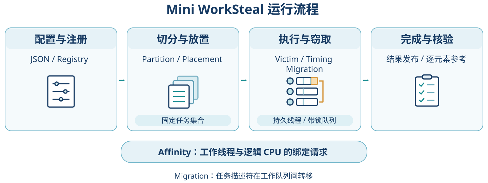
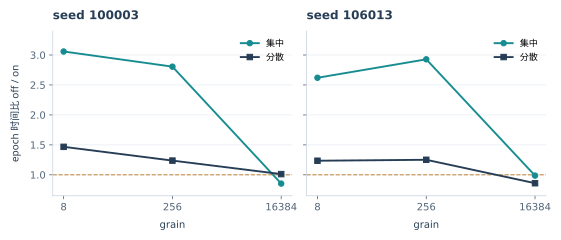

# Mini WorkSteal：可组合工作窃取运行时的实现与实验分析

LZUHPC 2026 秋季 HPC 创意题实验报告 | 实验记录截至 2026-10-25，文字修订于 2026-10-26

本项目研究固定总工作量下，任务粒度和初始不均衡对工作窃取收益的影响。我采用 C++20 持久线程池和带锁双端队列，将六类策略独立注册，再用固定任务集开展对照实验。实验在 i9-13900HX、Ubuntu 24.04 / WSL1 上进行，Windows 用于编辑和整理材料。

第十三轮固定优化后二进制和 16 个工作线程，在集中布局 grain=8/256 的两个新输入中，epoch 的 off/on 时间比为 2.62-3.06；粗粒度只剩 4/6 个任务时，没有稳定收益。窃取能够重新分配尚未开始的任务，但当前框架无法拆分单个任务。

实现优化按另一条路线推进：第二、三轮先改执行内核和配置，第四、五轮根据核验占比转向并行核验，第八轮再确认内存执行交错。它们改善了不同阶段，报告按各轮实际对照分别列结果，跨轮倍数不相乘。

调度策略最终保留 round_robin、immediate 和 single。批量窃取与空闲退避均未通过新输入的采用标准。局部性实验的证据仍不充分：工作集覆盖了 LLC 两端，但动态诊断未发生成功窃取，尚无法量化窃取引起的缓存损失。

|题面要求|本文对应内容|
|---|---|
|独立、可声明、可组合的策略|第1章：六类策略、注册扩展与并发生命周期|
|量化均衡、开销与局部性，覆盖 LLC 两端|第2-5章：固定工作量对照、512 KiB / 288 MiB 及证据限制|
|多种尝试后给出策略组合|第6-10章：确认结果、负结果、配置与项目复盘|
|代码、环境和连续 Prompt File|第11章与附录：功能复现、来源和附件状态|

报告依次说明实现选择、实验过程、对照结果和保留配置。结论限于本机、已测输入及候选范围；跨平台表现和 WSL1 下的线程物理驻留仍需验证。

# 工作说明：实现内容与设计取舍

项目工作分为运行时实现和策略实验两部分。我先搭建支持策略替换的固定任务运行时，再通过对照实验选择配置。下表列出实现内容、检查方法和主要代码入口。

|工作内容|实现与检查|主要入口|
|---|---|---|
|并行运行时|持久线程池、本地双端队列、窃取、完成发布、异常恢复与关闭；支持重复执行固定任务集|src/runtime/worker_pool.cpp|
|可组合策略|六类独立决策接口、JSON 工厂注册；用额外注册文件验证扩展不修改旧运行时|include/worksteal/policy.hpp；tests/register_reverse.cpp|
|工作负载与对照|确定性均匀/偏斜计算、重复内存访问；串行、静态、集中队列及同框架窃取开关|src/workloads/；configs/|
|核验与实验工具|逐元素参考、Python 独立小规模重算、诊断/预热/计时分组、冻结顺序、统计及散列归档|tests/；tools/；各轮 runs/|
|优化与复现|比较实现和配置，在新输入上确认；保存未采用的方案、对应构建和 Linux 功能复现记录|docs/14-48；report/；submission/|

## 固定任务集与带锁队列

固定任务集和带锁队列属于本项目的实现选择。任务集合在执行前确定（docs/08，D003），便于用剩余任务数判断结束，也便于保持不同策略的工作量一致。我采用互斥锁保护队列，使任务转移和异常退出流程更容易检查，相应的锁与同步成本计入后面的粒度实验。

## 策略接口与运行时分离

策略接口分别决定任务粒度、初始放置、victim、窃取时机、迁移数量和线程亲和性，运行时处理取锁、任务执行与完成通知。比较 single 和批量窃取时，可以复用执行流程，仅替换迁移策略。初始放置和亲和性分开配置：前者决定任务所属队列，后者提出线程的逻辑 CPU 绑定请求；数据的缓存驻留需要另外验证。

## 工作量一致性与正确性检查

输入由 seed 和元素编号确定。调整粒度和执行顺序后，每个元素的迭代次数保持一致，并逐元素接受完整标量参考核验。独立 Python 小规模参考用于交叉检查输入、输出和散列。运行时另查任务恰好执行一次、结果发布和异常恢复；逐任务诊断使用单独进程，与正式计时分开。

实现参考了已有的工作窃取规则和实验方法，来源见附录。本项目侧重策略组合、正确性检查和本机实验比较。

# 探究过程：实验安排与方案调整

各轮实验记录了候选、对照、采用条件和最终选择。下面按实际轮次说明实验方向的调整，后补诊断按发生时间单独列出。

## 1. 调度策略的初步比较

第一轮改变粒度、初始偏斜和工作集大小，比较同框架 off/on，并加入串行、静态和集中队列对照。集中偏斜时窃取有收益，均衡布局改善很小，因此后续调度实验重点检查剩余可分配任务的数量和成本。随机 victim、half 等候选未通过两个新输入的确认，本轮保留默认组合。记录见 docs/08、13。

## 2. 执行内核与参数优化

第二轮为完成计数批处理、窃取暂存、LTO 和独立递推链设置开关，先比较十种构建，再筛选线程数和粒度，第三轮补充确认。重计算从 lanes8 获益，轻任务更受框架开销影响；单独开启 LTO 或 scratch 的效果也随负载变化。联合配置同时改变多项因素，报告据各轮实际对照解释收益。记录见 docs/14、15、17。

## 3. 根据耗时分布调整优化对象

第三轮的独立阶段观测中，uniform/skewed 完整核验的耗时占比中位数约为 96.5%/97.1%，因此继续优化执行阶段对应用总耗时的影响有限。第四轮转向并行核验，保留逐元素独立标量重算，仅改变核验任务的分配方式，第五轮再用新输入确认。阶段观测单独保存，未并入正式计时组。记录见阶段观测汇总及 docs/18、22。

## 4. 内存执行与初始化成本

第五轮之后，继续检查内存初始化和身份散列。第六至十一轮比较并行填充、免预清零、执行递推交错、参数调整、分块散列和交错生成，只有第八轮四路执行交错通过确认。第十二轮再用独立探针分析分配、填充和 FNV，观察到缺页成本随分配方式在阶段间转移。因此，初始化方案仍以完整应用时间评价，局部阶段缩短不足以说明净收益。此前未通过的结果均予保留。记录见 docs/22-36。

## 5. 优化后构建的窃取边界

第十三轮固定优化后的二进制，重新比较布局和粒度。细粒度任务仍可通过窃取重新分配；粗粒度只剩 4/6 个任务时，性能受不可拆大任务限制，victim 策略无法提供任务内部并行。随后批量迁移和空闲退避均未通过耗时标准，保留 single、immediate。第十六轮因资源条件未满足，仅有准备记录。记录见 docs/37-47。

## 批量窃取的验证与取舍

第十四轮检验批量迁移能否减少单位任务的窃取开销。实验固定二进制、线程数、粒度和输入，比较 single 与 cap4/16/64。筛选选中 cap4，但两个新输入分别只有 3/7、4/7 对 epoch 更快，第二输入 app 中位数还上升 8.01%，未达到预定采用条件。因此保留 single。筛选收益未在新输入上稳定保持，是这一轮放弃批量迁移的直接依据。记录见 docs/39、40。

上述实验分别涉及任务执行、参考核验、初始化和调度策略。第10章结合确认结果总结主要取舍及未完成的问题。

# 图解：运行流程与实验路线

图1a展示固定任务集的一次执行流程，图1b汇总各轮实验及方案选择。箭头表示执行流程或实验轮次的先后关系，图源与可编辑 SVG 保存在 figures/ 目录。

图1a：策略接口给出调度决策，运行时完成同步与执行，应用进行独立参考核验。Affinity 按逻辑 CPU 掩码配置，实际物理驻留尚未核实。

图1b：第六至十二轮同时包含优化尝试和独立诊断；第十三轮研究窃取边界，批量与退避均未采用。第十六轮只有准备，没有性能计时。

# 1. 架构与并发生命周期

worker 是工作线程，grain 是每个任务包含的元素数，victim 是被尝试窃取的线程。任务集合在执行前固定，不支持递归产生子任务、DAG 或 future；这个范围便于在工作量相同的前提下比较调度策略。

运行流程与实验路线见前页图1a、图1b。本节说明策略接口和并发生命周期。

|策略|职责|当前实现|
|---|---|---|
|Partition|划分任务粒度|fixed_grain、balanced_chunks|
|Placement|设置任务初始队列|按 home 或 round_robin 放置|
|Victim|选择窃取目标线程|round_robin、seeded_random|
|Timing|何时尝试、失败后如何等待|disabled、immediate、bounded_backoff|
|Migration|决定单次迁移的任务数量|single、capped_half|
|Affinity|配置线程逻辑 CPU 绑定|unbound、显式逻辑 CPU 列表|

实验保留直接串行、静态本地队列和集中队列对照。S3-off/on 共用工作窃取执行器，队列、锁、任务顺序和完成协议相同。除窃取开关外，空闲处理也有差异：off 等待，on yield。因此，这组耗时差同时包含空闲处理方式的影响。

本地线程（owner）从队尾取任务，窃取线程（thief）从队头取任务。迁移时先 try_lock 读取 victim 队列长度，解锁后调用策略，再次 try_lock，并按当前剩余数量裁剪。策略回调在锁外执行，迁移过程避免同时持有两把队列锁。启用暂存优化后，窃取的第一个任务直接执行，其余描述符进入本地队列。

完成协议由队列准备、任务发布和阶段退出组成。prepare 准备队列，run 持状态锁记录 t0，再推进 generation 释放 worker。各任务写入独立结果槽位，remaining 通过 seq_cst 原子读改写链发布完成。batch32 暂存完成数，线程在无任务可取、准备等待前必须先发布，避免剩余计数无法归零。最后完成者通知控制线程，run 还需等待全部 worker 退出本次执行阶段。

任务抛出异常时，线程池记下第一个 exception，停止开始新任务，等已开始的工作退出后再向调用者抛出。检查覆盖重复 epoch、异常恢复、关闭和拒绝并发提交。固定任务不允许等待池内其他任务，也不能在池内阻塞提交；析构会通知停止并 join，同步由锁和原子保证。

扩展检查在 tests/register_reverse.cpp 中新增注册 test_reverse，使 worksteal_extension 复用同一 ws_core。变更仅涉及新实现、注册单元和构建源清单。接口与执行入口见 include/worksteal/policy.hpp、src/runtime/worker_pool.cpp；非法配置在启动前拒绝。该方式属于静态注册扩展，第三方代码需遵守同一契约，未提供插件隔离。

# 2. 工作量、核验与实验方法

epoch 表示一次线程池执行阶段，app 表示应用内部总耗时，包含初始化和完整核验。报告同时列出两种时间，以区分执行阶段与完整应用的变化。

compute_uniform 用 seed 和元素编号生成输入，每个元素做 K 次 uint64 混合递推。compute_skewed 把前 N/8 个元素改为 9K 次，其余仍为 K 次。grain 只改分组，layout 只重排同一组任务；相同输入的迭代次数和最终输出必须一致，mix、元素和完整核验都保留。

memory_reuse 在固定的元素数据块上做带串行依赖的混合访问。指定 home 的线程先预读，预读单独计时；home 只是数据归属标记，不能保证数据实际留在缓存中。这个负载也尚未证明达到 DRAM 带宽饱和，不能直接当作 STREAM 类测试解释。

|量|定义与用途|
|---|---|
|epoch_seconds|线程池准备好后的统一释放到控制线程确认完成；含调度、同步、计算及唤醒|
|end_to_end_seconds|应用内部初始化、身份散列、分发、执行、完整核验及关闭的总墙钟|
|elapsed_process_seconds|采集器看到的进程墙钟；另含启动和最终序列化等|
|identity / output FNV|校验输入、成本、任务、初始队列及输出身份；不取代逐元素参考比较|
|diagnostic|额外逐任务计数、执行者和worker成本；与正式timing进程分开|

采样前固定输入、候选、构建、执行顺序、样本数和停止条件，诊断、预热、正式计时分别使用独立 run_id。全部成功样本参与中位数计算，包括较慢的运行。筛选所得候选在预定新输入上确认，未通过则停止，不改选第二名。采用标准属于工程选择规则，未进行统计显著性检验。

正确性分两层核对：小规模用独立 Python uint64 参考重算输出和 FNV，应用每次完整标量重算所有元素。并行核验采用独立参考计算、固定归并，输出散列按原顺序生成。诊断另查 exact_once，并用 task_executor 重建任务、元素和成本分布；最终执行者记录不足以重建任务的全部迁移过程。

每批运行前检查 Windows 负载和 WSL 中已知的冲突任务；条件不符时暂缓运行并保存记录。共享机器上的系统调度和频率变化仍可能影响计时，短 epoch 尤其敏感。运行前的负载检查只覆盖规定的观测窗口，不能证明物理独占。

# 3. 均匀任务：粒度与框架开销

均匀负载中，各元素的工作量相同。本节通过改变分组粒度和执行器，观察任务划分对完成时间的影响。

第一轮 W01 固定 N=262144、K=1024，比较 1 与 4 个逻辑 worker，grain=1/64/4096。下图和表格展示 p=4，每条件 3 次正式计时的中位数；单线程结果保存在原始汇总中。

图2：均匀任务的粒度对照（p=4，n=3/条件）。纵轴截取 205-213.3 ms 以显示细小差异，曲线起伏不能直接读成较大的百分比收益。

|grain|static ms|central ms|off ms|on ms|
|---|---|---|---|---|
|1|209.39|212.17|209.59|210.54|
|64|210.53|205.91|209.86|206.67|
|4096|208.26|205.73|206.67|206.06|

这组粒度条件的耗时差异较小，不足以支持普遍最优的选择。细粒度增加描述符、队列访问和完成通知，也可能引入假共享；粗粒度减少可分配任务数。图中呈现这些因素共同作用的耗时，现有计时无法分别量化队列锁等开销。

按 CS149 中的任务划分模型，在理想同速处理器上，完成时间的下界为 max(W/p,Cmax)，W 是总工作量，p 是处理器数，Cmax 是最大不可拆任务的工作量。粗粒度增大单个任务的影响，细粒度增加调度开销。本项目的 mix 为成本单位，不能直接换算为本机秒数，该模型用于定性分析。

第一轮 p4 标量版本中，随机 victim、退避和 half 均未通过两个新输入的采用标准。后续内核、线程数和运行时已有变化，旧结果仅作为当时的选择依据；新版本仍需独立对照。

# 4. 偏斜任务：窃取收益与粗任务限制

偏斜负载保持总工作量不变，通过集中放置重任务检验窃取的均衡效果，再增大 grain 检查粗任务限制。布局决定初始分配，粒度决定可重新分配的任务数量。

|第一轮布局|off ms|on ms|off/on|
|---|---|---|---|
|concentrated|989.04|407.39|2.428|
|spread|406.59|404.71|1.005|
|shuffled|418.11|411.84|1.015|

第一轮集中布局的 off/on 约为 2.428，分散和打乱布局接近 1。独立诊断观察到任务迁移及 worker 成本分布变化，但诊断未并入正式计时，无法从总时间中单独量化负载均衡的贡献。该轮构建、参数与后续实验不同，结果分别保留。

图3：优化后二进制的窃取开关对照（p=16，n=5/条件）。虚线 1 表示两组中位数相同；纵轴大于 1 表示开启窃取的 epoch 更短。

第十三轮固定优化后二进制、p=16 和 K=256，在两个新输入上各做 5 对 off/on。集中布局 grain=8/256 均为 5/5 对胜出；grain=16384 时，两种输入分别只剩 4/6 个任务，最大任务占总 mix 成本的 62.5%/58.33%，没有稳定收益。当前运行时无法拆分任务，调整 victim 选择也无法消除单个大任务的限制。全部 60 对记录见 stealing-boundary 审计。

粗粒度下，两种布局实际生成了相同初始队列。图上的点对应各自保存的计时组，但两组差别不能用布局来解释，也不能当作两个独立场景。

分散布局中，各 worker 的初始成本单位相等，开启窃取后仍观察到 epoch 缩短。成本单位相等未能保证完成时间一致；由于缺少独立核速度校准、稳定物理映射和 PMU 数据，现有结果尚无法确定原因。app 的改善较小，部分条件的变化方向也不一致。

# 5. 局部性：受控对照与证据限制

局部性实验固定数据 home、访问遍数和预读，受控改变执行者，并检查动态运行中的实际窃取。缓存迁移的归因还需要线程驻留和硬件观测，不能仅依据工作集大小判断。

本机是 i9-13900HX，CPUID leaf4 和 Windows 报告的 LLC 容量均约为 36 MiB。WSL1 下能核对请求的单 CPU 逻辑掩码，但无法稳定确认线程实际落在哪个物理核、是否共享缓存；也没有可用的 PMU 数据。这些条件限制了后面对缓存原因的解释。

|每任务工作集|相对36 MiB LLC|受控foreign/home：方向0|方向1|
|---|---|---|---|
|512 KiB|1/72|1.043|1.113|
|4.5 MiB|1/8|1.025|0.986|
|288 MiB|8|0.973|1.070|

每个条件有 3 次正式计时。上表固定工作集、访问遍数和预读，只在两个 home 方向改变执行者。大工作集和中间工作集的两个方向没有一致趋势；仅凭这些墙钟时间，还无法知道 cache miss、DRAM 流量和缓存迁移各占多少。

|动态布局|512 KiB off/on|4.5 MiB off/on|288 MiB off/on|
|---|---|---|---|
|policy|0.939|0.980|0.999|
|concentrated|0.992|0.993|1.034|

六个开启窃取的动态诊断均未发生成功窃取。执行者与 home 不一致也可能来自初始放置，因此无法将差异归因于动态迁移。现有工作集覆盖远小于、远大于 LLC 的两个尺度，但尚未测得动态窃取引起的缓存损失。题面允许局部性窗口接近零，现有结果仍不足以判断其代价。

后续局部性实验需要能核实物理驻留的 Linux 环境，并固定重复访问、预读和实际迁移条件。新环境数据将独立保存，不与本机历史样本合并。

# 6. 已确认优化及其作用阶段

第二轮把构建选择和线程数、grain 一起筛选。下表是入选方案在两个新输入上相对该轮参数基线的结果，每组均 5/5 对胜出。这些倍数包含多项变化，不能全部归给窃取；适用范围也仍是当轮的候选和输入。

|类别|seed|epoch基线/候选|app基线/候选|胜对|
|---|---|---|---|---|
|light|137|15.035|3.191|5/5|
|light|2027|14.958|3.385|5/5|
|uniform|137|13.886|1.264|5/5|
|uniform|2027|15.806|1.273|5/5|
|skewed|137|14.416|1.227|5/5|
|skewed|2027|14.285|1.214|5/5|
|memory|137|1.785|1.003|5/5|
|memory|2027|1.949|1.110|5/5|

batch32 按批发布完成计数，scratch 复用窃取暂存，LTO 允许跨翻译单元优化；compute_lanes8 交错推进八个独立元素，以增加指令级并行的机会。各元素的迭代和核验保持不变，lanes 数量也不直接代表 SIMD 宽度。第三轮补充确认后，仅轻任务更换联合配置，重计算保留第二轮选择。

|第八轮输入|epoch scalar→lanes4 ms|epoch比|app比|胜对|
|---|---|---|---|---|
|41011|9.0979→5.7864|1.572|1.077|7/7|
|47017|11.6156→6.6841|1.738|1.048|7/7|

第八轮把四个独立元素交错执行，两个输入的 epoch 都是 7/7 对胜出，达到至少 10% 改善并通过 app 退化限制。因此这项改动保留在该轮原构建的推荐中。数据生成、原 FNV 和完整标量核验都未省去，收益发生在任务内核。

第四、五轮改的是完整参考核验，其收益体现在应用总耗时，线程池执行的任务保持不变。第五轮三个类别在两个新输入上均为 7/7 对 app 胜出。这组对照与第二、八轮的基线不同，各轮倍数不能合并为共同基线上的总加速比。

四路交错的等价性也单独检查过。memory 中每个元素的下一步依赖当前 x，但不同元素的 x 和数据区间独立。新实现轮流推进四个元素，对每个元素仍保留原来的 pass、word 顺序，尾部不足四个就退回标量；完整标量参考还会逐元素重算。具体实现和边界检查见 docs/28。

# 7. 未采用方案与验证结果

|轮次|研究问题|实际决定|
|---|---|---|
|6|并行初始化填充|确认不足，保留initialization_workers=1|
|7|overwrite省去预清零|第二输入仅5/7胜，保留zeroed|
|9|memory p×grain参数|没有≥5%筛选候选，按协议停止|
|10|生成时分块执行同一FNV|阶段费用移动，app未稳定改善，保留separate|
|11|四路独立word生成|两输入app仅4/7、2/7胜，保留fill1|
|12|分配/填充/FNV成本探针|仅诊断，不据探针推翻应用负结果|
|14|single对照cap4/16/64|筛选选cap4，但两个新输入确认失败|

第十二轮用独立 noinline 探针补查初始化：zeroed 的 40/64 MiB 条件下，填充中位数约 3.25/5.32 ms，分配清零约 28.77/47.26 ms，完整 FNV 约 36.08/56.91 ms。overwrite 会把大量 minor faults 移到填充阶段。这些时间包含多种成本，不能直接算成应用收益；原 FNV 又有串行依赖，部分散列算完后也不能随意拼接成同一结果。

|第十四轮集中输入|epoch single→cap4 ms|胜对|app single→cap4 ms|
|---|---|---|---|
|116009|3.7183→3.6328|3/7|31.6320→30.2063|
|122011|5.0438→5.1210|4/7|38.1532→41.2096|

cap4 在筛选中使 epoch 下降约 22.7%，但未在新输入上稳定改善，第二输入 app 中位数上升 8.01%。诊断显示成功 steals 减少、成本单位分配更均衡，同时描述符迁移总量增加。我按事前标准保留 single，并在确认失败后结束本轮选择，未改选其他候选。

一次窃取可以转移多个描述符，同一任务也可能多次迁移，因此最终执行者不足以重建完整迁移过程。新输入的耗时不支持采用 cap4；锁竞争、等待和重复迁移的各自贡献，现有诊断尚无法量化。

# 8. 第十五轮：空闲退避的独立对照

第十五轮固定原 Release、p16、K256、round_robin 和 single，比较 immediate 与已有的 bounded_backoff。前者失败后 yield；后者从连续失败第 32 次起，请求固定 50 微秒的条件变量等待，取得任务后清零失败计数。本轮未测量实际等待时长、上下文切换或功耗。

表中 epoch 前/后依次为 immediate / backoff，app 比为 immediate/backoff。“护栏通过”表示该条件未超过预定退化限制；采用退避要求两个主要目标与全部护栏同时通过。

|seed / N|grain|布局|epoch 前/后 ms|胜对|app 比|条件判定|
|---|---|---|---|---|---|---|
|128021 / 73728|8|集中|2.6266 / 3.2192|1/7|1.003|主目标失败|
|134033 / 106496|8|集中|4.4083 / 4.3146|4/7|1.010|主目标失败|
|128021 / 73728|8|分散|2.5516 / 2.8653|2/7|1.022|护栏失败|
|134033 / 106496|8|分散|4.0882 / 3.8714|4/7|1.053|护栏通过|
|128021 / 73728|256|集中|3.1062 / 2.8777|4/7|1.011|护栏通过|
|134033 / 106496|256|集中|3.9146 / 5.1685|0/7|0.927|护栏失败|
|128021 / 73728|256|分散|2.9882 / 3.0766|5/7|1.008|护栏通过|
|134033 / 106496|256|分散|3.9945 / 3.9559|5/7|1.021|护栏通过|

恢复批次 20261025T014536Z-V15-idle-backoff-f9520b 共运行 152 个进程，其中 112 份为正式计时。采用规则在采样前规定：两个输入的 grain=8 集中布局都至少 6/7 对胜出，候选 epoch 中位数不超过基线的 95%；其余条件 epoch 不超过基线的 110%，全部 app 不超过基线的 105%。结果未通过。这些是本项目的选择标准，不是统计显著性保证。

首批因采集器身份缓存未区分 grain，在第 5 个 control 停止，正式计时为 0。5 份应用输出独立复核均正确，重放共享缓存复现了该错误。保存原件后，修正 grain 缓存命名空间，按 docs/43 在新目录重跑完整流程；原协议见 docs/41，失败批次与恢复样本分开归档。

诊断中，attempts 仅在第一处 victim 锁成功后增加，busy 包括两处取锁失败，因此 busy/attempts 不能解释为总失败率。empty、steals 描述窃取行为，其变化仍需结合耗时分析。逐对耗时、阶段时间和进程时间保存在 idle-backoff 审计与各 run 原件中。

退避未通过全部采用标准，因此保留 immediate 和既有推荐，未新增通用退避配置。

第十六轮计划比较 round_robin 与 seeded_random，两段等待后资源条件仍未满足，实际为 0 研究进程、0 计时。源码检查发现随机 victim 的同序号序列存在相关性，其对争抢和耗时的影响尚待实验验证。记录见 docs/46、47。

# 9. 保留配置与构建来源

|任务|worker / grain|执行/核验选择|配置入口|
|---|---|---|---|
|light|16 / 512|compute_lanes8 / ref1|configs/verified/light.json|
|uniform|32 / 1024|compute_lanes8 / ref32|configs/verified/uniform.json|
|skewed|32 / 256|compute_lanes8 / ref32|configs/verified/skewed.json|
|memory|16 / 4|memory_lanes4 / ref4|configs/memory-interleaved/memory.json|

ref 是完整参考核验的线程数，和执行任务的 worker 分开；compute_lanes8 / memory_lanes4 是任务内部交错的独立递推链数。这些配置都用 round_robin、immediate、single 和显式逻辑 CPU 掩码，输入规模看完整 JSON。第八轮第二输入在 memory-large.json；第十四、十五轮测的是 p16，不能据此重新选择表中的 p32 配置。

复现时需要区分功能和历史耗时。下一章的命令用于检查当前代码；要追溯表里的时间，还需对应的冻结源码、编译选项、环境和原二进制。下表给出定位用的短散列，完整 SHA256、选项和快照路径在 builds.json 与 evidence-index.json 中。

|任务|测量构建|binary / source 的 SHA256 前16位|
|---|---|---|
|light|full_lanes8|c52674ba1244813d / e85c97b09468b4a3|
|uniform|lanes8|a33d749dd756ba85 / e85c97b09468b4a3|
|skewed|full_lanes8|c52674ba1244813d / e85c97b09468b4a3|
|memory|Release / memory_lanes4|3b98bf25474bfc27 / 4c9cdd0f4aacf04a|

构建差异：full_lanes8 使用 batch32、scratch、LTO 和八路计算链；uniform 的 lanes8 使用 batch1、关闭 scratch，保留 LTO 与八路链。memory 的四路交错由配置指定。重建时要使用各自记录的选项。

策略层采用 fixed_grain、round_robin victim、immediate、single 和显式逻辑掩码。初始队列还同时受 placement 与 layout 控制：skewed 配置使用 concentrated，memory 使用 policy。因此复现必须读取完整 JSON，仅照抄 worker/grain 不足以还原实验。

配置选择随负载和调用方式变化。细粒度集中偏斜可以从任务重新分配中获益；均衡负载或一次性小任务仍需与串行、静态、集中队列比较应用总时间。输入规模、线程数或机器改变后，需要重新检查这些对照。

# 10. 项目复盘：主要结果与不足

本项目完成了可更换策略的运行时，并通过多轮实验选择实现和配置。下表汇总窃取开关、联合配置和内存执行内核三组对照，详细条件与数据见前文各章。

|实验对照|任务执行表现|应用总时间表现|
|---|---|---|
|第十三轮集中，p16，grain8/256；off→on|时间比 2.62-3.06；两个输入各条件 5/5 胜|改善小于 epoch；按条件报告，见第4章|
|第二轮 uniform；参数基线→联合配置|时间比 13.886-15.806；两个输入各 5/5 胜|时间比 1.264-1.273，见第6章|
|第八轮 memory；同二进制 1路→4路|时间比 1.572 / 1.738；各 7/7 胜|中位数降低 7.19% / 4.60%；仅作退化护栏|

表中时间比均为各自对照的中位数之比。第十三轮的 off/on 还包含空闲等待与 yield 的差异；第二轮联合改变了构建和参数；第八轮只在同一新二进制内比较。它们回答不同问题，不能相乘，也不代表最终程序相对某个共同原版的总加速比。

## 实现与实验工作

实现上，六类策略分开注册，新增 test_reverse 时复用已有运行时，验证了题面要求的扩展方式。检查覆盖任务恰好执行一次、结果发布、异常恢复和关闭。内核优化与完成计数批处理后，仍使用独立 Python 小规模参考和完整标量核验检查输出一致性。

批量窃取和空闲退避均未通过采用条件，相关结果完整保留。第十五轮还发现采集器的缓存键未区分 grain，导致首批中止。我先保存失败记录，独立复核应用输出，再修正缓存键，在新目录重跑完整流程。此次故障来自采集器的身份检查；失败批次与恢复批次分别归档。

功能复现使用复制到新目录的 147 份源文件，三种 Release 均运行了 CTest，六个原推荐配置通过完整核验。历史耗时的复现还需要还原对应构建、输入和运行条件。容器尚未实际构建，具体状态见第11章及复现记录。

## 结果分析

粗粒度实验的限制主要来自任务划分。只剩 4/6 个任务时，部分线程即使空闲，也无法参与已开始的大任务。当前运行时没有任务内拆分机制，调整 victim 选择只能改变剩余任务的分配。

执行阶段优化后，完整核验占据了应用的大部分耗时。第四、五轮因此转向并行核验。epoch 与 app 同时记录，使这一阶段变化能够被识别，也避免仅凭任务执行时间评价完整应用的表现。

批量窃取减少了成功 steals 次数，但新输入上的耗时未稳定改善，因此没有采用。诊断计数用于分析执行行为，方案选择仍依据预先规定的耗时标准和退化限制。

## 局限与后续工作

局部性的证据仍不充分。工作集覆盖了 LLC 两端，但六组动态诊断均未发生成功窃取，线程物理驻留和缓存域也未能可靠核实，因此尚无法量化窃取引起的缓存代价。第十六轮仅完成准备，未采集计时数据。现有配置选择限于本机、已测输入和候选范围。

提交前还需实际检查容器、核对早期附件缺失说明，并将新版报告加入提交包。后续实验优先考虑局部性和随机 victim：前者需要核实线程驻留并观察到实际窃取，后者需要验证序列相关性对争抢和耗时的影响。两项工作均需另行规定对照并保存新样本。

# 11. 复现方法与待完成事项

Linux 环境需要 CMake、C++20 编译器、pthread、Python3 和 nlohmann-json3-dev。Ubuntu 24.04 可安装 build-essential、cmake、python3、nlohmann-json3-dev。生成报告另需 report/requirements.txt 中的库，程序本身不依赖报告库。

cmake -S . -B build -DCMAKE_BUILD_TYPE=Release

cmake --build build -j2

ctest --test-dir build --output-on-failure

./build/worksteal --list-policies

./build/worksteal --config configs/runtime/diagnostic.json

要重建优化版本，还需按 builds.json 设置 WS_COMPLETION_BATCH、WS_STEAL_SCRATCH、WS_ENABLE_IPO、WS_COMPUTE_LANES。只编默认 Release 不会得到表里的优化内核。IPO 先做 CMake 能力检查；没有使用 fast-math 或 march=native。

复现检查时，把 147 份源文件复制到新目录，默认、full、uniform 三种 Release 都运行了 CTest，六个原推荐配置也通过完整核验。命令、日志和新 binary 散列保存在 submission/reproduction/20261025/receipt.json。这检查的是程序功能；若要比较旧耗时，还需要还原当时的构建、输入和运行条件。

并发检查覆盖空集合、单任务、少任务、多线程、重复 epoch、恰好一次执行、输出发布、异常恢复、退出和拒绝并发提交；扩展注册与非法 CLI 输入另查。第十一轮的 Release、ASan/UBSan、TSan 各有 2551 项 runtime 检查和 497 次 CLI 调用记录。这些数目对应各轮保存的构建，重新编译后的检查结果需要另记。

DevContainer 配置已写好，但本机没有可调用的容器引擎，尚未实际构建。现在完成的是原生 Linux 功能复现。题面推荐 DevContainer，也允许提供其他可复现环境说明。

连续 Prompt File 保存在 submission/prompts/session-20261025-v16-resource-close，范围是同一真实 Session 从起点到 2026-10-25T02:28:05.332Z：47 条用户消息、318 条可见助手消息，含 JSON、Markdown 和来源前缀散列。这份快照只收录该时刻之前的可见对话，不含思维链，也没有拼接其他 Session。

两张早期临时截图的原路径已失效，持久日志只留下文本块。因此，对话文字可以核查，图片附件还不完整；缺失部分没有补写 OCR 或重造图片。记录见 submission/prompts/attachment-availability-20261025.json。

AI 辅助包括资料搜集、备选方案梳理、部分代码编写和数据整理，具体过程见随附连续对话记录。

# 附录：证据入口与学习资料

|范围|数据 / 解释入口|
|---|---|
|第一轮与W01-W03|results/study-summary.json；report/实验与策略选择报告.md|
|联合实现/参数优化|optimization/results/optimization-summary.json；docs/15|
|轻任务与参考核验|refinement、verification、confirmation-retry；docs/17、19、22|
|初始化与内存内核|initialization、allocation、memory-kernel；docs/24、26、28|
|负结果与成本诊断|memory-tuning、blocked-identity、fill-interleaved、init-cost；docs/30、32、34、36|
|优化后机制与批量|stealing-boundary、batch-migration；docs/38、40|
|退避与恢复原件|idle-backoff、idle-backoff-collector-failure；docs/41、43|
|最终验收|docs/42-最终交付验收台账.md；submission/README.md|
|冻结综合输入|report/final/input-data.json；原图位于 report/final/figures/|
|本稿索引与生成器|report/student/evidence-index.json；tools/student_report.py|

每轮的计划、配置、日志、环境、校验和及源码与二进制来源都保留在对应目录。这次整理重新核对了报告选用的 579 份正式 run、59 份当前或冻结输入，并另查 12 份历史阶段观测。观测不并入正式计时，579 也不是全部研究进程数。evidence-index.json 可以按章节找到计时组和原件散列。

版本与保存情况：这份报告由 tools/student_report.py 生成，可编辑正文、SVG 与索引位于 report/student/。10月26日只整理文字和图表，没有新增性能样本或重跑 sanitizer。Linux 与 Windows 镜像都验过散列，但仍在同一物理盘上，独立故障备份还没补齐。旧候选 ZIP 尚未更新，提交前需要加入本稿，补齐个人信息并核对群内要求。材料尚未对外提交。

官方题面：github.com/LZUOSS/LZUHPC，立项核对commit 33dad592cd74d8cf36ae7921a29c0e8393034a70；本地原文及版本说明见reference/README.md。 2026 年 10 月 25 日保存的 GitHub API 核查记录确认三份题目文档未变，见 reference/upstream-20261025-api/verification.json。

方法来源包括 oneTBB 的 How Task Scheduler Works、Controlling Chunking、Bandwidth and Cache Affinity，Google Benchmark 的 User Guide 和 Random Interleaving，以及 Blumofe 的 Cilk 调度说明。精确链接在 docs/11。我借鉴的是已有队列规则和实验方法，不声称发明工作窃取，也不把 Cilk 递归依赖模型的理论保证套到本项目的固定任务、带锁队列上。

本项目与 CS149 的任务划分、动态负载均衡和同步开销相对应。工作量与跨度用于分析大任务限制，独立依赖链用于理解 lanes；局部性实验还需考虑缓存容量与复用。epoch 大幅下降而 app 改善有限的结果，则体现了 Amdahl 定律对整体收益的约束。
