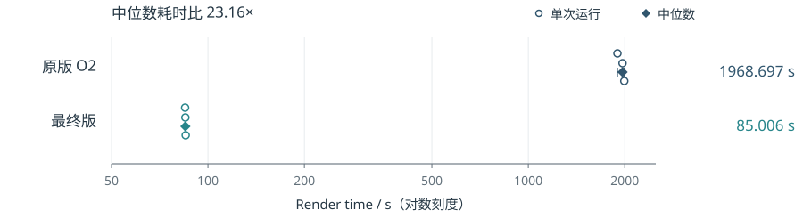

# HPC 方向技术报告

光线追踪优化与 Mini WorkSteal 运行时

兰州大学超算队 2026 年秋季纳新 · 报告日期 2026-10-27

这次我做了光线追踪题，并选做了 Mini WorkSteal。光追部分从像素并行和减少求交次数入手，保持原来的采样和图像结果。WorkSteal 部分实现一个小型运行时，比较任务粒度和初始分配对窃取收益的影响。正文选几组能说明取舍的实验，其他尝试和复现方法见文末仓库中的附录。

|项目|最终方案|主要结果|
|---|---|---|
|光线追踪|O3、OpenMP 像素块并行、16 桶 SAH BVH、延后构造命中记录|Render time 中位数 1968.697 → 85.006 秒，耗时比 23.16；六份图像逐通道一致|
|WorkSteal|独立注册六类策略；保留 round_robin、immediate、single|同一优化二进制下，细粒度集中布局 off/on 的 epoch 时间比为 2.62-3.06；粗粒度未稳定获益|

实验都在本机 i9-13900HX、Ubuntu 24.04 / WSL1 上编译和运行。光追数据来自 10 月 15-16 日，WorkSteal 数据截至 10 月 27 日。这台电脑也用于日常工作，测试时没有固定频率、温度和后台负载；其中光追的耗时波动较大，第 2.3 节会具体说明。

图1：最终版本的渲染结果，由正式运行保存的 PPM 转换为 PNG。质量比较使用原始 PPM。

# 1 光线追踪的分析与实现

## 1.1 从哪里改起

原版逐像素采样，递归计算光线散射，每次查询场景都线性检查物体。这里有两处可以改：不同像素交给多个线程计算，场景查询用空间结构跳过不可能命中的物体。修改时保持题面规定的采样、散射、天空颜色和随机数规则，也没有改动 main.cpp、common.hpp 和 math/color.*。

## 1.2 按完整像素并行

我把一个像素的全部样本放在同一个线程里计算。每个像素本来就有独立随机流，这样能保持像素内部的计算顺序和随机数消耗顺序，OpenMP 只改变像素之间的执行顺序。最终按 16×8 像素块动态分配，chunk 为 1，在本机使用 32 个线程。

多个线程如果直接往同一个文件流写入，会互相竞争。我先让各线程写自己的像素缓冲，等并行计算结束，再按原行列顺序输出，额外需要约 18.54 MiB 内存。缓冲分配、计算和文件输出都计入 Render time；BVH 则在场景初始化时建立，耗时另记。

## 1.3 用 BVH 减少无效求交

BVH 把场景物体分组，用包围盒组织成树。光线没碰到一个盒子，就不用再检查里面的物体。我比较了中位数划分和 16 桶 SAH；SAH 根据子盒面积和物体数量估计求交代价，再选择分组。每个叶子最多放 8 个物体。分桶无法有效划分时，回退到中位数划分。

遍历时先检查入口较近的子树，找到命中后，再用这个距离缩小后续检查范围。BVH 改变了物体的访问顺序，所以除了最近命中，还要处理等距命中和盒边界，保持与原版相同的选择。球体求交仍用 double 和原公式。

## 1.4 延后构造最终命中记录

原版每发现一个候选命中，就计算位置、法线和材质等信息。如果后面遇到更近的球体，刚算出的记录又会被覆盖。我先比较距离，确定最终命中哪个球体后，再补全记录。这条路径只对球体原类型启用，派生类和其他物体仍走原接口。

这一版还把该类型的距离计算改成了直接调用。两项修改放在一起测试，因此下文给出的是它们的组合效果。

LTO、PGO 和 SIMD 也做过比较，最终没有保留，相关结果见在线附录A。最终版本仍使用普通 O3 编译。

# 2 光线追踪的实验结果与取舍

## 2.1 正式配置与比较方法

正式配置为 1200×675、200 spp、最大深度 50、seed=42，以题目输出的 Render time 比较，包含渲染和文件输出。我把原版 O2 串行程序和最终版放在同一批测量，各运行三次。A 代表原版，B 代表最终版，顺序为 A1、B1、B2、A2、A3、B3；没有额外预热，也没有删去较慢的成功运行。

|配对|原版 O2 / 秒|最终版 / 秒|原版 / 最终版|
|---|---|---|---|
|1|1897.516|84.857|22.36|
|2|1968.697|85.006|23.16|
|3|1993.332|85.197|23.40|
|中位数|1968.697|85.006|23.16|

图2：条形表示中位数，圆点表示三次实际耗时，横轴从零起。23.16 是整套修改的耗时比，包含编译选项、算法、线程数和绑定的共同影响。原版与最终版都在本机测量，未使用题面 Xeon 的参考时间计算比值。

## 2.2 正确性与代表性局部对照

六次正式运行的图像与官方参考及同参数原版逐通道一致，MSE=0，PSNR 为无穷大，满足题目 45 dB 的要求。除整图比较，还检查了球体求交和记录差分，包括严格区间、等距命中、特殊方向、派生类型和场景生命周期。下面两组局部对照，每个版本各测三次，表中列中位数。

|局部对照|控制 / 秒|候选 / 秒|耗时降低|
|---|---|---|---|
|中位数 BVH → 16 桶 SAH|113.684|96.265|15.32%|
|立即构造 → 最终命中后构造|97.544|90.667|7.05%|

这两组实验来自不同批次，所以每一行只比较自己的控制与候选，不把倍数连乘。后期我采用的筛选规则是：三对都更快，而且候选最慢的一次仍快于控制最快的一次。这是用于选择方案的工程规则，不代表统计显著性检验。

## 2.3 耗时波动

同一个最终程序，较早一次独立验证测得 17.435 秒，这批却在 85 秒左右。这个差距还没有查明原因，因此文中的整体耗时比只按同批测得的数据计算，没有拿不同批次的最快值拼起来。WSL1 下也没取得可靠的硬件采样，求交、缓存和同步各占多少时间，目前没有可靠数字。

# 3 Mini WorkSteal 的设计与实验安排

## 3.1 固定任务集与策略接口

这个题除了要求实现工作窃取，还要比较负载均衡、调度开销和局部性损失。我采用持久线程池和带互斥锁的双端队列，先固定任务集，再开始执行，不支持运行中递归提交子任务。这样不同策略处理的是同一批工作，也能用剩余任务数判断是否结束；队列锁和同步的时间照常计入。

图3：策略决定如何分配和窃取，运行时负责同步和执行，应用核验计算结果。Migration 移动的是任务描述符；Affinity 设置线程绑定，但绑定本身不能保证数据仍在某一级缓存中。

|策略|职责|代表实现|
|---|---|---|
|Partition|任务切分与粒度|fixed_grain、balanced_chunks|
|Placement|任务初始队列|按 home 或 round_robin 放置|
|Victim|选择窃取目标|round_robin、seeded_random|
|Timing|窃取与空闲等待时机|disabled、immediate、bounded_backoff|
|Migration|单次转移的任务数量|single、capped_half|
|Affinity|配置线程绑定|unbound、显式逻辑 CPU 列表|

每个线程从自己的队尾取任务，空闲时从其他队列的队头窃取。任务各自写入独立结果槽位，完成后再通知运行时。测试检查任务是否恰好执行一次，以及重复调用、异常恢复和关闭是否正常。我还增加了 test_reverse 策略来检查扩展接口，只需新增实现、注册单元和构建源清单，不必改动已有运行时。

## 3.2 工作负载和对照

我用三类负载分别观察问题：均匀负载看粒度和调度开销，偏斜负载看窃取能否分担工作，重复内存访问看换线程后的局部性。输入由 seed 和元素编号确定，改变 grain（每任务元素数）只改变分组。结果逐元素用标量计算重算，小规模再与独立 Python 参考实现比较。

实验还比较了串行、静态队列和集中队列。关闭窃取（off）与开启窃取（on）使用相同的队列、锁、初始任务顺序和完成协议。不过，off 空闲时等待，on 空闲时 yield，所以两者的时间差也包含空闲处理的影响。下文的 epoch 是线程池执行时间，app 是包含初始化和完整核验的应用总时间。

# 4 任务粒度与窃取收益

## 4.1 均匀负载中的开销对照

第一轮固定元素数 N=262144、基础迭代次数 K=1024，采用 4 个逻辑 worker，每个条件三次正式运行。表中为 epoch 中位数，单位毫秒。

|grain|静态队列|集中队列|窃取关闭 off|窃取开启 on|
|---|---|---|---|---|
|1|209.39|212.17|209.59|210.54|
|64|210.53|205.91|209.86|206.67|
|4096|208.26|205.73|206.67|206.06|

任务切得越细，描述符、队列访问和完成通知就越多；切得太粗，又可能没有足够任务分给线程。这组耗时差异较小，还不能据此选出通用的最佳粒度，也无法单独算出队列锁等环节的成本。off/on 比较反映的是整条调度路径的变化。

## 4.2 偏斜布局与不可拆大任务

第十三轮使用同一个优化程序，固定 16 个 worker 和 K=256，换两个输入，每个布局与粒度各做 5 对 off/on。集中布局下，grain=8 和 256 对应的四组比较中，开启窃取均为 5/5 对更快，epoch 中位数时间比为 2.62-3.06。分析任务成本时，我用整数混合运算 mix 的迭代次数作单位，它不是实际耗时。

图4：时间比为 off 中位数 / on 中位数，大于 1 表示开启窃取更快；虚线为 1。每条件 n=5。粗粒度下，两种布局实际形成相同初始队列，因此不能将两组差异解释为布局效应。

grain=16384 时，两个输入分别只有 4 个和 6 个任务，最大任务占总成本单位的 62.5% 和 58.33%，窃取没有稳定收益。因为已开始的任务不能再拆开，即使换一种 victim 选择方式，也无法让更多线程分担这个大任务。分散布局下，成本单位相同的任务仍可能用时不同，原因还没有定位；app 的改善也小于 epoch。

# 5 局部性与最终策略选择

## 5.1 换线程执行对局部性的影响

本机报告的末级缓存（LLC）约为 36 MiB。我选了 512 KiB、4.5 MiB 和 288 MiB 三种每任务工作集，覆盖远小于和远大于 LLC 的情况。实验固定 home（数据归属标记）、访问遍数和预读，只改变执行线程，每个条件测三次。

|每任务工作集|相对 LLC|方向0 foreign/home|方向1 foreign/home|
|---|---|---|---|
|512 KiB|1/72|1.043|1.113|
|4.5 MiB|1/8|1.025|0.986|
|288 MiB|8|0.973|1.070|

表中 foreign/home 表示换线程与原归属线程执行的耗时比，两个方向没有一致趋势。另做的六组动态诊断都没有成功窃取，初始放置却可能已经改变执行者。加上 WSL1 下缺少可靠的缓存驻留和 PMU 数据，这组实验还不能量化动态窃取的局部性损失，也不能说明损失为零。题目要求的三种效应，目前还没有充分分开。

## 5.2 批量窃取的代表性尝试

一次多取几个任务，可能减少反复窃取的开销。我在第十四轮固定程序、线程数、粒度和输入，比较 single 与 cap4/16/64。cap4 筛选时较快，因此再换两个输入，每个输入做 7 对比较。下表是集中布局的结果。

|输入 seed|epoch single→cap4 ms|更快对数|app single→cap4 ms|
|---|---|---|---|
|116009|3.7183 → 3.6328|3/7|31.6320 → 30.2063|
|122011|5.0438 → 5.1210|4/7|38.1532 → 41.2096|

cap4 在筛选时让 epoch 下降约 22.7%，但换输入后只有 3/7、4/7 对更快，第二组 app 中位数还增加了 8.01%。虽然诊断显示成功窃取次数减少、成本分配更均衡，但迁移的描述符总量也增加了。收益不够稳定，最后仍用 single。

## 5.3 最后保留的配置

最后保留 fixed_grain、round_robin victim、immediate、single 和显式逻辑 CPU 掩码，初始队列由 placement 与 layout 决定。线程数和粒度按负载选择，见在线附录B。完整核验并行化、内存执行交错也有收益，但改变的是其他阶段，详见在线附录A。

光追的主要改进是减少无效求交，并让不同像素并行计算。WorkSteal 则更依赖任务怎么切、最初怎么分：队列里还有可分担的工作时，窃取才有机会缩短等待；只剩几个不可拆的大任务时，更换策略也难以补足并行度。当前配置是本机这些负载下的选择，换机器或负载后还需要重新比较。

## 源码与补充实验

代码、构建步骤、补充实验和原始记录放在下面的仓库版本中：

https://github.com/daicy2005/lzuhpc-2026-hpc/tree/af6a1615f9975d3e191324c3a8cb6e9bc89a399a

连续对话记录（Prompt File）暂未上传。

AI 辅助包括资料搜集、备选方案梳理、部分代码编写和数据整理。
